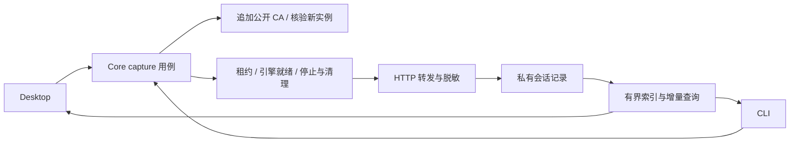

# 抓包启动与生命周期优化审计 — 2026-10-14

本次基于最新主线 `c7a0db4`（Arca 2.0.6，原 MUX）完成本地实现与预览，尚未提交、推送或发布。本机正式安装版仍为 MUX 1.13.0。

## 结论与证据边界

实际安装的 Pi 可以被识别。独立 Pi 进程的 HTTP、HTTPS、gzip SSE 与 HTTP 代理出口请求均得到 200；真实 Desktop 界面的开始记录、列表、响应正文、脱敏与目标退出停止也已通过。本机测试 API 返回确定性响应，模型 ID 为 `gpt-6-luna`；这些实验不代表调用了外部 GPT 服务。

用户此前一次失败的完整报错尚未提供，不能宣称已经找到其唯一原因。已确认本机系统未信任抓包 CA；已有 Agent 无法在运行中继承新的 CA 环境。新实例启动实验发现系统终端启动器一直不返回，采样定位到 `application::terminals::dispatch` 等待子进程输出。新实现已将这条等待限制为 10 秒并返回 `agent_launch_timeout`，没有自动改变系统信任或自动化权限。完整的终端自动启动成功路径仍待本机启动器可用后验收。

## 已修复的实现问题

| 问题 | 改动与目的 |
|---|---|
| 引擎错误输出被完全丢弃 | `engine.rs` 持续排空 stdout/stderr，仅以固定规则返回错误分类；原始输出不保存、不返回，缓冲窗口有固定上限。失败原因保存在私有会话目录，历史仍可查询。 |
| 启动/停止长时间占用 `ACTIVE` | 全局互斥锁只负责持有/移交 worker；预检、就绪等待与停止在锁外执行。文件租约仍保证同一资产目录只有一个引擎。 |
| 新启动 Agent 后仍可能选择旧实例 | Core 共用 `start_session`，新实例追加公开 CA，比较启动前后带出生时间的进程身份，只接受覆盖其辅助进程的唯一新根；多实例歧义直接返回错误。CLI 与 Desktop 共用此流程。 |
| 终端或系统启动器无界等待 | App、Terminal/iTerm/Ghostty、Warp 使用同一个有界启动器；10 秒超时后只结束本次启动器。 |
| 引擎超时仅杀掉包装器 | 引擎拥有专属进程组，失败/超时清理该组与租约，不终止 Agent。插件也核验所属进程与包装器的出生时间，避免包装器退出后留下不可见引擎。 |
| CA 文件创建不等于写入完成 | 首次启动仅在缺少 CA 时使用无监听、无拦截模式初始化。等待完整 PEM，再结束初始化器；CA 读取复用有界、拒绝符号链接的文件读取。现有 CA 不替换。 |
| 继承的代理环境与所选出口冲突 | 仅对新抓包实例临时清空标准代理环境，并设置 NO_PROXY；真实配置不改写，出口交给抓包引擎。已有实例保持原有配置。 |
| 原生 mitmproxy 配置可能覆盖启动参数 | 官方 12.2.1 在 `--set` 后加载配置。适配器在配置阶段重新约束 lazy connection、upstream_cert、rawtcp、streamed-body retention、raw dump 和 TLS 校验；保留合法的上游 CA 配置。 |
| 历史会话与当前 Agent 混淆、错误藏在弹窗后 | 默认历史限定为入口 Agent；设置中显示缺少条件；失败统一走主线 ToastNotice，在所有弹窗之上只显示一条通知。加载中不把 Agent 错标为“尚未适配”。 |

## 架构

`mod.rs` 负责会话用例与公共协议；`launch.rs` 负责公开 CA 与新实例绑定；`engine.rs` 负责引擎所有权、有界诊断与清理；`targets.rs` 负责权威启动器匹配；Python adapter 负责协议转发与脱敏。CLI/Tauri 保持薄适配，React 只管理选择与显示。

CLI 可使用 `arca capture environment`、`capture run --target ...`、`capture run --launch --directory ...`、`capture state` 与 `list/show`。官方中英文指南原先“CLI 不启动抓包”的陈述已修正。原有录制协议与品牌迁移行为保持不变。

## 验证

- Rust CLI debug、release sidecar、Tauri dev 与 TypeScript/Vite 生产编译通过。
- Pi + 本机 HTTP：200，pending → streaming → complete，gzip SSE 正文增长且完整，凭据 canary 不出现在抓包 JSON。
- Pi + 本机 HTTPS + HTTP CONNECT 代理：200，代理确实收到连接，完整 SSE 与脱敏通过。加入原生配置冲突后仍通过，原始 flow dump 保存字节为 0。
- 可控加载错误：返回 `capture_addon_failed`，错误分类与失败历史都不包含原始 canary。
- 可控无响应引擎：返回 `capture_engine_timeout`；引擎与其继承租约的子进程均退出，文件锁可重新获取。
- 所属引擎退出：有效 Core 状态为 failed，记录仍可查看，租约释放；不能只以旧 status.json 的 running 字段判断存活。
- 新进程启动：首次 CA 初始化成功；本机终端启动器返回有界的 `agent_launch_timeout`，成功路径未验收。
- 真 Desktop + 独立 Pi：POST 200，完整脱敏响应可在 Response 页面查看，目标退出后自动停止。1200×820 与 900×600 下列表、正文与操作按钮可用。
- 按项目极速模式，没有运行 cargo/npm 测试套件、fmt、clippy、图标或交付检查。

实验原件与截图保留在父工作区 Git 忽略的 `workspace/local/research/mux-capture-repair-2026-10-14/`，不进入功能提交。原有未跟踪的 `analysis/15-agent-scoped-trace.md` 保留。

## 参考

- [mitmproxy 12.2.1 启动源码](https://github.com/mitmproxy/mitmproxy/blob/v12.2.1/mitmproxy/tools/main.py)：配置加载次序。
- [mitmproxy local mode](https://docs.mitmproxy.org/stable/concepts/modes/#local-capture)：按进程拦截范围。
- 本仓 [原抓包工作台审计](16-agent-capture-workbench.md)：先前逐客户端验证及其限制。
